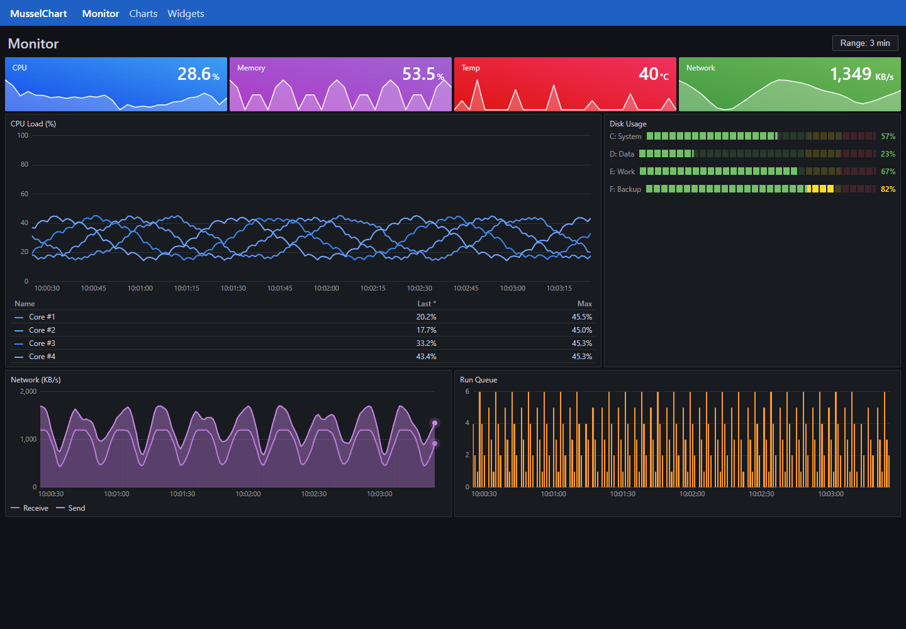
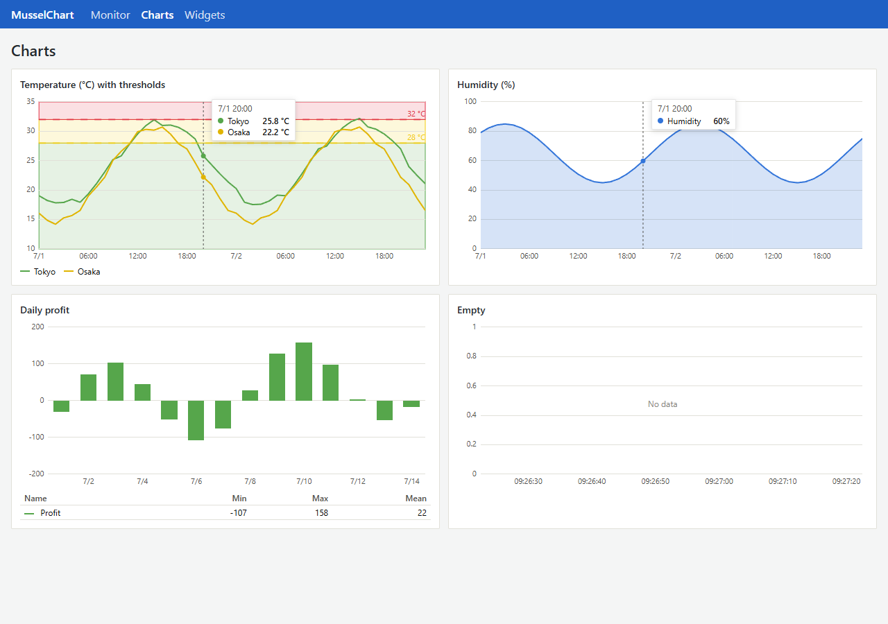
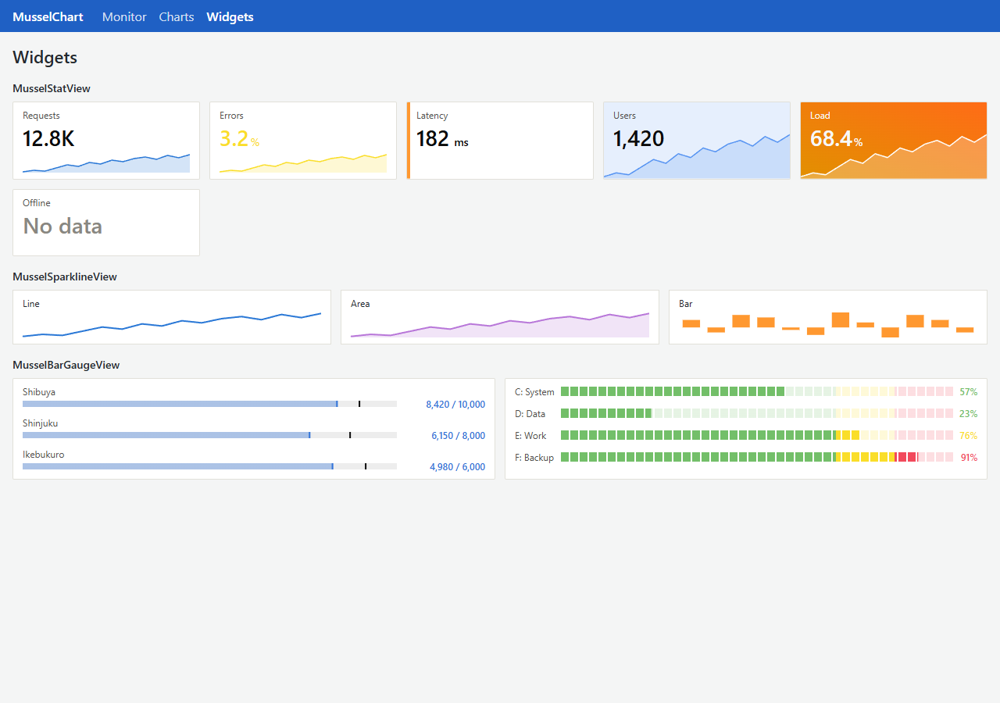

# MusselChart - Charts for Blazor

[](https://www.nuget.org/packages/MusselChart/)

## 🐚 What is this?

Charts for Blazor drawn as SVG, made for dashboards and widgets.  
Lines, areas, bars, KPI tiles, sparklines and bar gauges follow the look of [ClamChart](https://github.com/usausa/clam-chart) and stay light on Blazor Server, where only the new points go over the circuit.  

| 🖥️ Monitoring board | 📈 Charts | 🔢 Widgets |
|:-:|:-:|:-:|
|  |  |  |

## 🚀 Quick Start

Import the namespace; the styles come with the `{App}.styles.css` of the application.  

```razor
@using MusselChart
```

Write the axes and the series inside a chart.  

```razor
<MusselChartView Height="240" TrackingGroup="monitor">
    <DateTimeAxis WindowSize="TimeSpan.FromMinutes(3)" />
    <NumericAxis Minimum="0" Maximum="100" />
    <LineSeries Items="Samples" X="static x => x.Time" Y="static x => x.Cpu" Title="CPU" ValueFormat="{0:N1}%" />
</MusselChartView>
```

Fill a `ChartRingBuffer<T>` from a background service; every page shares it and each chart draws only the new items.  

```csharp
public ChartRingBuffer<Sample> Samples { get; } = new(190);
```

## 🎨 Look

| Part | Detail |
|---|---|
| Theme | CSS variables (`--mussel-primary-text`, `--mussel-grid-line` and more) with light defaults; `musselchart.css` adds the dark `mussel-dark` |
| Colors | `Palette` (`ChartPalettes`: default, Grafana, Material and shades) or `Color` of a series |
| Thresholds | Lines and bands on charts, the state of tiles and the colors of gauges |
| Tiles and gauges | `ColorMode` and `LayoutMode` of a KPI tile, basic and segmented gauges |

## ✅ Supported features

| Category | Detail |
|---|---|
| **Charts** | Line, area and bar series in one chart, stacked areas, KPI tiles, sparklines and bar gauges |
| **Axes** | A date and time axis with a sliding window, a numeric axis with fixed and soft ranges |
| **Data** | Typed `X` and `Y` delegates, `ChartRingBuffer<T>` read incrementally, gaps for missing values |
| **Interaction** | A crosshair and a tooltip on hover or touch, shared by `TrackingGroup`, and legend toggles |
| **Legend** | A list or a table with last, minimum, maximum and mean |

## 📖 API

See the [API reference](Document/API.md).  
